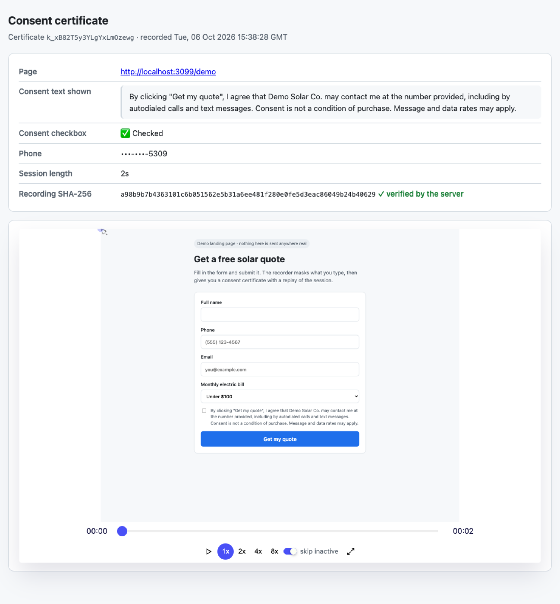
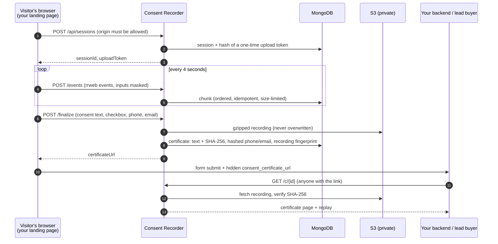

<div align="center">

# 🛡️ Consent Recorder

**Privacy-first session recording that turns web form submissions into tamper-evident consent certificates.**

Add one `<script>` to a lead form. Every submission gets a certificate showing the exact consent text the visitor saw, whether they ticked the box, and a replay of the session. **What people type is masked, and is never recorded.**

[](https://github.com/rafiulhc/consent-recorder-starter/actions/workflows/ci.yml)
[](https://nodejs.org)
[](https://expressjs.com)
[](https://www.rrweb.io)
[](https://www.mongodb.com)
[](LICENSE)

[Try the demo](#try-it-in-30-seconds) · [How it works](#how-it-works) · [Security & privacy](#security--privacy) · [Add it to a form](#add-it-to-your-form) · [API](#api) · [Deploy](#deploy)

<br/>



<sub>A certificate from the demo. The replay shows the form exactly as the visitor saw it, with their typed answers masked.</sub>

</div>

---

> [!NOTE]
> This is a technical starter, not legal advice. Consent rules (TCPA, state laws, GDPR…) differ by country and change over time. Have the consent wording on your forms reviewed by a lawyer.

## ✨ Highlights

- **🧾 Proof of consent:** each certificate stores the consent text exactly as it was shown, the checkbox state, the page, the time, and a replay of the session.
- **🔒 Private by default:** every input is masked in the recording. Phone numbers and emails are stored only as keyed hashes plus the last 4 digits, so a database leak doesn't expose them.
- **🧬 Tamper-evident:** recordings get a SHA-256 fingerprint when the certificate is issued, and the server checks it every time the recording is served.
- **🚪 Locked down:** unguessable 128-bit certificate links, an admin API protected by a token, recording only from websites you list, rate limits, size limits and a strict CSP. Every security feature stays **off until configured**, never open.
- **🗑️ Retention and deletion:** abandoned sessions expire automatically, certificates are deleted after `RETENTION_DAYS`, and one API call deletes a certificate with its recording.
- **🔌 Easy to embed:** one script tag and a few `data-` attributes. The certificate link is added to your form automatically.
- **✅ Tested:** 68 offline tests, a storage contract suite run against real MongoDB in CI, and a browser test confirming that typed values never reach the recording.

---

<a id="try-it-in-30-seconds"></a>

## 🎮 Try it in 30 seconds

No database, S3 or accounts needed. Everything runs in memory:

```bash
git clone https://github.com/rafiulhc/consent-recorder-starter.git && cd consent-recorder-starter
npm install
npm run demo
```

Open **http://localhost:3000/demo**, fill in the form (use made-up details), tick the box and submit. Then click through to your certificate and press ▶ on the replay. Your typed answers show as `****`.

---

<a id="how-it-works"></a>

## 🧠 How it works



1. **Recording:** the browser opens a session. The server stores only a **hash** of the upload token, so a database leak can't be used to add events to someone's recording.
2. **Uploading:** events are sent in numbered chunks. A retried chunk is recognized as a duplicate, and each session has a size limit and a time limit.
3. **Finalizing:** on submit, the recorder captures the consent text and checkbox from the page. The server compresses the recording, fingerprints it with SHA-256, stores it in S3 so it can never be overwritten, and issues a certificate with a random ID.
4. **Delivering:** the recorder adds the certificate link to your form as a hidden field, so it travels with the lead to your backend or buyer.
5. **Verifying:** whoever opens the link sees the certificate and the replay. The server rejects a recording whose fingerprint no longer matches.

---

<a id="security--privacy"></a>

## 🔐 Security & privacy

Consent recorders hold exactly the data attackers want: names, phone numbers, emails and recordings of people filling in forms. These are the common ways such systems leak, and how each one is designed out here, with tests that guard it:

| Risk | How it's handled |
|---|---|
| Anyone can list or search recordings | The admin API needs `ADMIN_TOKEN`, compared in constant time. **Without the setting, the API is off (503), never open** |
| Recordings can be found by guessing a phone number or database ID | No lookups by phone number or ID. Certificates use **random 128-bit IDs**. Admin search requires a **full** phone number, so a last-4-digit search can't return someone else's recording |
| Replays show everything people typed | `maskAllInputs` is on in the recorder, so the replay shows `****`. A browser test checks that typed values never reach the recording |
| A database leak exposes phone numbers and emails | Stored only as **HMAC-SHA256** hashes (with `PII_HASH_SECRET`) plus the last 4 digits for display |
| Other websites use your recorder, or bots flood it | Only origins in `RECORDER_ALLOWED_ORIGINS` (checked on the server, not just through CORS), rate limits per IP, and size limits per chunk and per session |
| Someone tampers with a recording later | A SHA-256 fingerprint is stored in the certificate and checked on every read. Uploads to S3 can't overwrite an existing recording |
| Leaked links work forever | Recordings are streamed through the app, never exposed through public or pre-signed S3 URLs |
| Certificates get indexed, cached or embedded in other sites | `X-Robots-Tag: noindex`, `Cache-Control: no-store`, `frame-ancestors 'none'` |
| Recorded page content (XSS) runs on the certificate page | Everything is HTML-escaped, and a nonce-based CSP blocks other scripts. rrweb replays never run recorded scripts |
| Data is kept forever | Abandoned sessions expire, certificates are removed after `RETENTION_DAYS`, and there's an API to delete one certificate |
| Third-party CDN risk | rrweb and the player are served from your own server, pinned to exact versions |
| Secrets in code | Everything comes from the environment. `.env` is ignored by git |

---

<a id="add-it-to-your-form"></a>

## 🧩 Add it to your form

```html
<script src="https://consent.yourdomain.com/recorder.js" defer></script>

<form data-consent-form action="/your-lead-endpoint" method="post">
  <input type="tel" name="phone" data-consent-phone>
  <input type="email" name="email" data-consent-email>
  <label>
    <input type="checkbox" data-consent-checkbox required>
    <span data-consent-text>I agree that Example Co. may contact me at the number provided…</span>
  </label>
  <button>Submit</button>
</form>
```

| Attribute | Purpose |
|---|---|
| `data-consent-form` | Forms to certify. On submit, the recorder waits for the certificate (up to 6 s), adds it as the hidden field `consent_certificate_url`, then submits. **It never blocks a submission.** |
| `data-consent-text` | The consent wording to capture, word for word |
| `data-consent-checkbox` | The consent checkbox, so its state is recorded |
| `data-consent-phone` · `data-consent-email` | Sent once at submit, and stored only as hashes plus the last 4 digits |
| `data-consent-mask` · `data-consent-block` | Mask other sensitive text, or leave an element out of the recording entirely |

Use `<script … data-field="cert_url">` to change the hidden field's name. In single-page apps, call `await window.ConsentRecorder.finalize(formElement)` yourself.

---

<a id="api"></a>

## 📡 API

| Method & path | Auth | Purpose |
|---|---|---|
| `GET /recorder.js` | — | The embeddable recorder |
| `POST /api/sessions` | Allowed origin | Start a recording → `{ sessionId, uploadToken }` |
| `POST /api/sessions/:id/events` | Allowed origin + upload token | Upload `{ seq, events }` |
| `POST /api/sessions/:id/finalize` | Allowed origin + upload token | `{ consent: { text, checked }, lead: { phone, email } }` → `{ certificateId, certificateUrl }` |
| `GET /c/:id` | The link itself | Certificate page with replay |
| `GET /c/:id/json` | The link itself | Certificate as JSON, for buyers' systems (no hashes, IP address or user agent) |
| `GET /api/admin/certificates?phone=&email=&from=&to=&page=&limit=` | `Bearer ADMIN_TOKEN` | Search by full phone number, email or date |
| `GET /api/admin/certificates/:id` | `Bearer ADMIN_TOKEN` | Full certificate, including IP address and user agent |
| `DELETE /api/admin/certificates/:id` | `Bearer ADMIN_TOKEN` | Delete a certificate and its recording |
| `GET /health` | — | Liveness check |

---

## ⚙️ Configuration

Copy [`.env.example`](.env.example) to `.env`. The main settings:

| Variable | Default | Purpose |
|---|---|---|
| `PUBLIC_URL` | `http://localhost:3000` | Base URL used in certificate links. **Use HTTPS in production** |
| `RECORDER_ALLOWED_ORIGINS` | *(none: recording off)* | Websites allowed to record |
| `ADMIN_TOKEN` | *(none: admin API off)* | Token for the admin API |
| `PII_HASH_SECRET` | *(none: phone and email not stored)* | Key for hashing phone numbers and emails, at least 32 characters |
| `STORAGE` · `MONGODB_URI` | `mongo` | Database (`memory` for development) |
| `BLOB_STORAGE` · `S3_BUCKET` | `s3` | Where recordings go (`local` for development) |
| `RETENTION_DAYS` | `1825` | How long certificates are kept |
| `STORE_IP` | `true` | Store visitors' IP addresses (shown to admins only) |
| `TRUST_PROXY_HOPS` | `0` | Set to `1` behind Heroku, Render or a load balancer |
| `MAX_CHUNK_BYTES` · `MAX_SESSION_BYTES` · `MAX_SESSION_MINUTES` | 2 MB · 20 MB · 60 | Upload limits |

---

## 🏗 Architecture

| File | Responsibility |
|---|---|
| [`src/service.js`](src/service.js) | All business rules: sessions, events, finalizing, certificates, search, retention. No Express code, with storage and clock injected |
| [`src/app.js`](src/app.js) | HTTP layer: routes, origin checks, rate limits, CSP, error handling |
| [`src/security.js`](src/security.js) | Tokens, constant-time comparison, admin auth, phone and email normalization, PII hashing |
| [`src/store/`](src/store) | `MongoStore` and `MemoryStore`, with the same interface and one shared test suite |
| [`src/blobs/`](src/blobs) | S3 (encrypted at rest, never overwritten), local disk and memory |
| [`src/views/certificate.js`](src/views/certificate.js) | Certificate page and the public JSON view |
| [`public/recorder.js`](public/recorder.js) | The browser recorder: masking, ordered retried uploads, form integration |
| [`server.js`](server.js) · [`scripts/demo.js`](scripts/demo.js) | Production entry point (with hourly retention) · in-memory demo |

---

## 🧪 Testing

```bash
npm test
```

| Suite | Covers |
|---|---|
| [`service.test.js`](test/service.test.js) | Upload tokens, retried and out-of-order chunks, size and time limits, finalizing exactly once, recovery when storage fails, PII hashing, tamper detection, search (including refusing last-4-digit searches), deletion, retention |
| [`http.test.js`](test/http.test.js) | Origin checks, CORS without credentials, admin auth and failing closed, HTML escaping on certificates, security headers, what the public JSON leaves out, safe file serving, no leaked internals |
| [`store.contract.test.js`](test/store.contract.test.js) | One behaviour suite for `MemoryStore` **and** `MongoStore`, including concurrent finalizes. CI runs it against a real MongoDB 7 |
| [`config.test.js`](test/config.test.js) | Safe defaults, required settings, phone and email normalization, token and hash helpers |

Before release, a headless-Chrome run of the demo also confirmed that a submitted form produces a certificate, that **the stored recording contains none of the typed name, phone or email**, and that the certificate page replays without CSP errors.

---

<a id="deploy"></a>

## ☁️ Deploy

1. Create a MongoDB database (a free Atlas tier works) and a **private** S3 bucket. Give the app an IAM user or role limited to `s3:PutObject`, `s3:GetObject` and `s3:DeleteObject` on that bucket.
2. Set the environment variables from `.env.example`. Generate the secrets with:

   ```bash
   node -e "console.log(require('crypto').randomBytes(32).toString('base64url'))"
   ```

3. Run `npm start` behind HTTPS. On Heroku, the included `Procfile` does this. Set `TRUST_PROXY_HOPS=1`.
4. Add the script tag to your form, and add the form's origin to `RECORDER_ALLOWED_ORIGINS`.

---

## 🗺 Roadmap

- [ ] Admin dashboard UI (search, view, delete)
- [ ] Signed webhooks that send certificates to CRMs or lead buyers
- [ ] Optional expiry for certificate links, and access logs per certificate
- [ ] Docker image and Terraform for S3 and IAM
- [ ] Encrypt recordings with a customer-managed KMS key

## 🛠 Tech stack

Node.js 20 · Express 5 · rrweb 2 · MongoDB 7 · AWS S3 (SDK v3) · helmet · express-rate-limit · node:test · GitHub Actions

## 👤 Author

**Rafiul Hasan Chowdhury** · [LinkedIn](https://www.linkedin.com/in/hrafiul) · [GitHub](https://github.com/rafiulhc)

## 📄 License

[MIT](LICENSE). Provided **as is**, with no warranty, and not legal advice.
